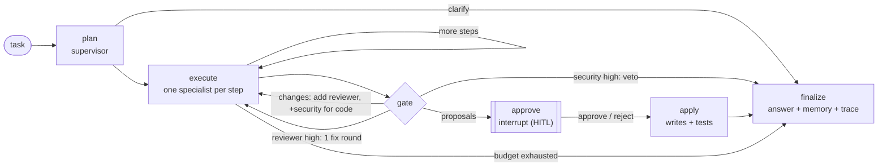

# Agents

> PAIEP's multi-agent layer (M6): a **LangGraph** supervisor/router that runs **CrewAI-style YAML
> personas** with **least-privilege tools**, bounded chains, a quality gate and **human approval** before
> any file is written.
> Setup & operations: [`docs/setup/06-agents.md`](../docs/setup/06-agents.md) ·
> Design: [Phase 07](../docs/phases/07-agent-ecosystem.md) ·
> Decision: [ADR 0008](../docs/adr/0008-agent-orchestration.md) (+ M6 amendment) ·
> Security: [ADR 0006](../docs/adr/0006-security-model.md).

## Layout

```text
agents/
├── personas/*.yaml        # 15 executable persona configs (role/goal/backstory + tier/tools/scope/guardrails)
├── orchestrator/          # LangGraph runtime: supervisor, agent loop, graph, router, checkpoints, trace, CLI
├── tools/                 # default-deny tool policy + tool implementations
├── requirements.txt       # LangGraph pins (no CrewAI dependency)
└── *.md                   # seed specs (Phase 07 narrative per agent)
config/agents.yaml         # budgets, quality gate, context sizes, checkpoint backend
config/router.yaml         # tier -> model per hardware profile, via the gateway
config/tool-policy.yaml    # global tool kill-switches, approval flags, protected paths
```

## Roster

Enabled personas are routable now; the rest are defined (validated at load) and are enabled one at a time
as they are validated (roster grows incrementally — M6 prompt).

| # | Agent | Persona(s) | Tier | Writes | Status | Seed spec · Config |
|---|-------|-----------|------|--------|--------|--------------------|
| 0 | Supervisor / Planner | orchestration | general | — | ✅ enabled | [md](supervisor.md) · [yaml](personas/supervisor.yaml) |
| 1 | Architect | P3, P4 | reasoning | `docs/`, `architecture/`, `experiments/**/*.md` | ✅ enabled | [md](architect.md) · [yaml](personas/architect.yaml) |
| 2 | Data Engineer | P2 | coding | `experiments/`, `rag/`, `tests/` | disabled | [md](data-engineer.md) · [yaml](personas/data_engineer.yaml) |
| 3 | Software Engineer | P1 | coding | `experiments/`, `rag/`, `memory/`, `scripts/`, `tests/`, `benchmarks/` | ✅ enabled | [md](software-engineer.md) · [yaml](personas/software_engineer.yaml) |
| 4 | AI Engineer | P14 | coding | `benchmarks/`, `models/`, `rag/` | disabled | [md](ai-engineer.md) · [yaml](personas/ai_engineer.yaml) |
| 5 | Documentation Writer | P5, P6 | general | `docs/`, `knowledge/`, `experiments/` | ✅ enabled | [md](documentation-writer.md) · [yaml](personas/documentation_writer.yaml) |
| 6 | Reviewer | P11 | reasoning | read-only | ✅ enabled (gate) | [md](reviewer.md) · [yaml](personas/reviewer.yaml) |
| 7 | Refactoring Agent | P1 | coding | code dirs | disabled | [md](refactoring-agent.md) · [yaml](personas/refactoring_agent.yaml) |
| 8 | Testing Agent | P1, P14 | coding | `tests/`, `experiments/` | disabled | [md](testing-agent.md) · [yaml](personas/testing_agent.yaml) |
| 9 | DevOps Agent | P13 | coding | `docker/`, `scripts/` | disabled | [md](devops-agent.md) · [yaml](personas/devops_agent.yaml) |
| 10 | Security Agent | P12 | reasoning | read-only | ✅ enabled (gate, **veto**) | [md](security-agent.md) · [yaml](personas/security.yaml) |
| 11 | Learning Coach | P7 | general | read-only | disabled | [md](learning-coach.md) · [yaml](personas/learning_coach.yaml) |
| 12 | Research Assistant | P8 | general | read-only | disabled | [md](research-assistant.md) · [yaml](personas/research_assistant.yaml) |
| 13 | Knowledge Manager | P9 | general | `knowledge/` | disabled | [md](knowledge-manager.md) · [yaml](personas/knowledge_manager.yaml) |
| 14 | Project Planner | P10, P4 | reasoning | `experiments/`, `docs/` | disabled | [md](project-planner.md) · [yaml](personas/project_planner.yaml) |

**Enable a persona:** set `enabled: true` in its YAML (validated at load: known tools/tier, review personas
read-only, memory types require `memory.write`), then re-run the routing eval
([`benchmarks/m6/`](../benchmarks/m6/)). No code change.

## Flow



1. **Plan** — the supervisor picks the fewest specialists via JSON-schema-constrained routing (enum of
   enabled personas); invalid output falls back to keyword routing; ambiguous requests return a clarifying
   question.
2. **Execute** — each step is a `request` message with enforced constraints (allowed tools, fs scope,
   budgets). The agent pre-fetches KB + memory context, may call **one read tool per turn**
   (`rag.retrieve`, `memory.read`, `fs.read`, `vcs`), then answers with a structured result. File edits
   become **proposals** (policy-checked, not written); test runs become queued **actions**.
3. **Gate** — deterministic checks first (requested files present, Python compiles, no destructive
   shrink → one fix round for the responsible builder). Then, for changes, Reviewer (docs) or Reviewer +
   Security (code) are scheduled automatically. **Security high = veto** (task blocked, nothing applied).
   **Reviewer high** → one bounded remediation round with the findings, then re-review; still high → blocked.
4. **Approve** — the graph **interrupts** with diffs, reviews, open gate issues and proposed memory writes;
   state is checkpointed (Postgres schema `agents`), so approval can happen later from another process:
   `agent approve <task>` / `agent reject <task>` (optionally per path).
5. **Apply** — writes are re-checked against policy at apply time; approved tests run (fixed argv, no
   shell); approved memory writes are committed.
6. **Finalize** — deterministic aggregated answer with citations; a `task_summary` memory (M5); JSONL trace.

## Guardrails

| Risk | Control |
|------|---------|
| Runaway chains on CPU | `max_agent_steps`, `max_llm_calls`, per-agent tool turns, task timeout → **partial** result, never loops |
| Unreviewed changes | Writes are proposals until the gate passes **and** a human approves; truncated/blocked tasks never apply |
| Incomplete work | New files named in the request must be proposed; proposed `.py` must compile; one bounded fix round, then open issues are shown at approval |
| Blind overwrites | Modifying an existing file requires reading all of it (`fs.read`) in the same step; files over `max_read_bytes` cannot be rewritten; shrinking a file by >50% is flagged |
| False memories | Agent memory writes are approved together with the changes (dropped if rejected/no approval); task summaries record facts (status, agents, files), never model claims |
| Over-permissioned tools | Tool usable only if globally enabled **and** in the persona allow-list; `shell`/`container`/`web.fetch` off |
| Path escape / secrets | Workspace-relative paths only; `..`, absolute and symlink escapes rejected; `deny_globs` (`.env`, keys, `.git`, DBs) |
| Self-modifying guardrails | Agents cannot write `config/tool-policy.yaml`, `config/agents.yaml`, `config/router.yaml`, `agents/personas/`, `agents/tools/`, CI workflows |
| Prompt injection via files/KB | Context and tool output are labelled reference data; structured output; human approval before effects |
| Unsafe code | Security persona veto on high severity |
| Weak model review | A 7B reviewer misses logic bugs (observed in M6); deterministic checks + approved test runs + the human diff review are the real gate |
| Silent failures | Every hand-off, model call, tool call, denial, approval and write is in the JSONL trace |

## Communication contract

Messages follow [Phase 07 §5](../docs/phases/07-agent-ecosystem.md#5-communication-contract-message-schema--described-not-coded)
(`msg_id`, `task_id`, `parent_id`, `from`/`to`, `intent`, `goal`, `inputs`, `context_refs`, `constraints`,
`artifacts`, `status`, `severity`, `citations`, `timestamp`) — implemented in
[`orchestrator/contract.py`](orchestrator/contract.py), carried in the LangGraph state and the trace.
Hand-offs pass **references** (paths, memory ids, citations) and short summaries, not payloads; only gate
reviewers receive proposed file content (capped by `context.review_chars`).

## Shared memory

| What | Where | Who writes |
|------|-------|-----------|
| Task state (plan, results, proposals, approvals) | LangGraph checkpoints — Postgres schema `agents` (SQLite on Profile A) | runtime |
| Long-term facts / decisions / notes | M5 `memory_item` + Qdrant (typed per persona: `memory_write_types`) | personas — **only when approved** with the task, scoped to the task scope |
| Task summaries (factual: status, agents, files changed) | M5 `task_summary` | supervisor (finalize) |
| Audit trail | `/data/agent-traces/<task>.jsonl` | runtime |
