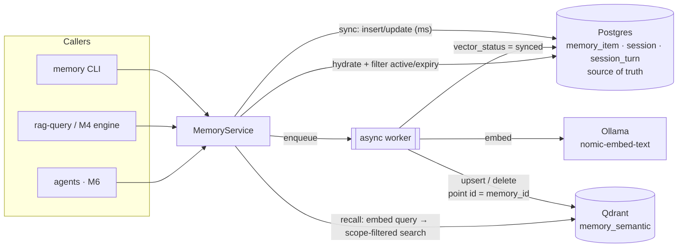

# 05 — Memory Service (M5)

> **Milestone:** [M5 — Memory Service](../../implementation/M5-memory.md) ·
> **Anchor:** O3 (FR-010–014), [Phase 08 §5–§6](../phases/08-knowledge-memory.md) ·
> **Decision:** [ADR 0009](../adr/0009-vector-store-and-memory.md) ·
> **Depends on:** M1 (embeddings), M2 (`memory_semantic` collection); integrates with M4 (RAG).

PAIEP remembers durable facts, preferences and decisions **across sessions and projects**, lets you
**view/edit/delete** every memory (FR-013), keeps project memories **isolated by scope** (FR-012), and
forgets on purpose so recall stays sharp. Everything runs locally and offline.

---

## 1. Architecture



**Consistency model.** Postgres is the source of truth. Every **active** memory has exactly one vector;
non-active ones have none. A row change sets `vector_status='pending'` (an **outbox** flag); the worker
embeds and upserts (or removes) the vector, then marks it `synced` — only if the row was not edited in the
meantime (`updated_at` guard). Recall always **hydrates from Postgres**, so a stale or dangling vector can
never surface a deleted/archived memory. `memory check --repair` reconciles any drift.

Code: [`memory/service/`](../../memory/service/) · Schema: [`memory/migrations/`](../../memory/migrations/) ·
Design notes: [`memory/README.md`](../../memory/README.md).

| Module | Responsibility |
|--------|----------------|
| `config.py` | Load `config/memory.yaml` (+ overlay via `MEMORY_CONFIG`), DSN from env |
| `db.py` | sqlite3 / psycopg adapter; versioned up/down migration runner |
| `vectors.py` | `QdrantIndex` (A+) and `LocalIndex` (SQLite brute-force cosine, Profile A) |
| `service.py` | CRUD, dedup, supersede, recall, sessions, consolidation, forgetting, outbox worker, check |
| `cli.py` | `scripts/memory-cli.py` (Compose service `memory`) |

## 2. Data model

| Table | Purpose | Key columns |
|-------|---------|-------------|
| `memory_item` | Long-term memory (canonical) | `type`, `scope`, `content`, `content_hash`, `confidence`, `status`, `superseded_by`, `vector_status`, `last_reinforced_at`, `expires_at` |
| `session` | One conversation/task | `scope`, `task_id`, `status` (open/closed/expired), `expires_at`, `summary_memory_id` |
| `session_turn` | Turns inside a session | `seq`, `role` (user/assistant/fact/system), `content` |
| `memory_vector` | **SQLite only** — local vector index | `scope`, `vector_json` |

- **Types:** `fact`, `preference`, `decision`, `entity`, `progress`, `task_summary`, `note`.
- **Statuses:** `active` → `archived` (decay/cap/scope-prune/user) · `superseded` (newer fact) ·
  `merged` (near-duplicate folded into an existing memory) · `expired` (TTL). Only `active` is recalled.
- **Scope:** `global` or `project:<name>`. Project recall **includes global** memories by default
  (`recall.include_global`); `--no-global` restricts to the project. Other projects never leak in.

## 3. Lifecycle

| Stage | Rule (config key) |
|-------|-------------------|
| **Write** | `remember()` inserts the row and returns in ms; vector sync is async (`writes.async`) |
| **Exact dedup** | Same normalised text + scope → reinforce the existing item, no new row |
| **Semantic dedup** | Cosine ≥ `dedup.semantic_threshold` (0.92) vs. an active item of the same type/scope → `merged` |
| **Reinforce** | Each time a memory is cited in an answer: `confidence += reinforce_step`, `last_reinforced_at = now` |
| **Supersede** | Newer fact replaces an older one; old row kept as history (`superseded_by`) |
| **Session → long-term** | On close: `fact` turns and user turns starting with `remember:`/`note:` are promoted (`consolidation.*`); optional LLM summary → `task_summary` (`summarize_with_llm`, off on CPU) |
| **Session eviction** | Turns deleted on close (`evict_on_close`); oldest dialogue turns dropped beyond `session.max_turns`; idle sessions expire after `session.ttl_hours` (consolidated first) |
| **TTL** | `expires_at` (per item or `retention.default_ttl_days` per type) → `expired` |
| **Decay** | effective = `confidence × 0.5^(days unused / half_life_days)`; below `archive_below` → `archived` (exempt: `preference`, `decision`) |
| **Size cap** | Beyond `max_active_items`, lowest effective confidence → `archived` |
| **User delete** | Hard delete of row **and** vector (FR-013) |
| **Scope prune** | `archive-scope project:<x>` when a project ends |

Decay is **computed** from timestamps, never compounded, so running `maintain` often is safe.

## 4. Configuration

| File | Use |
|------|-----|
| [`config/memory.yaml`](../../config/memory.yaml) | A+ default: Postgres + Qdrant, all policy defaults |
| [`config/memory.profile-a.yaml`](../../config/memory.profile-a.yaml) | Profile A overlay: SQLite + local vectors (no Postgres/Qdrant) |
| [`config/rag.yaml`](../../config/rag.yaml) → `memory:` | Memory-in-context for RAG (top_k, threshold, char budget, reinforce) |

Env: `MEMORY_CONFIG`, `MEMORY_DSN` (full override), `POSTGRES_PASSWORD`, `MEMORY_SQLITE_PATH`,
`QDRANT_URL`, `OLLAMA_BASE_URL`, `EMBED_MODEL`, `CHAT_MODEL`. Set `POSTGRES_PASSWORD` in `docker/.env`
**before the first start** — it is baked into the `paiep_db` volume at initialisation.

## 5. Run

```bash
cd docker
docker compose --profile memory up -d ollama qdrant postgres   # + scripts/qdrant-init.sh once (M2)
docker compose --profile memory build memory                   # after code changes

alias mem='docker compose --profile memory run --rm memory'     # or: make memory ARGS='...'
mem migrate status                                               # schema auto-migrates on first use
mem add "I prefer pytest over unittest" --type preference
mem add "PAIEP vectors live in memory_semantic" --type decision --scope project:paiep
mem recall "which test framework?" --scope project:paiep         # project + global
mem list --scope project:paiep         mem get <id>
mem edit <id> --content "..."          mem supersede <id> "newer fact"
mem delete <id>                        mem archive-scope project:old
mem session start --scope project:paiep            # -> <sid>
mem session add <sid> fact "The gateway is on 127.0.0.1:8081"
mem session close <sid> [--summarize]               # promote + evict
mem maintain --dry-run                 mem maintain
mem check [--repair]                   mem stats
```

**With RAG (M4):** memories are recalled and prepended to the context as cited sources
(`memory:<type>/<id>`); sessions add multi-turn history.

```bash
docker compose --profile rag run --rm rag "Which test framework should I use?" --scope project:paiep --new-session
docker compose --profile rag run --rm rag "And which formatter?" --scope project:paiep --session <sid>
docker compose --profile rag run --rm rag "..." --no-memory    # pure M4 path
```

Memory is **fail-soft** in RAG: if Postgres/Qdrant are down, answers continue from documents only.

**Profile A (16 GB, CPU-only):** no Postgres/Qdrant for memory, only Ollama for embeddings:

```bash
docker compose --profile inference up -d ollama
docker compose --profile memory run --rm --no-deps \
  -e MEMORY_CONFIG=/app/config/memory.profile-a.yaml memory add "..."
```

Schedule `mem maintain` (cron/Task Scheduler, e.g. daily) until the M6/M9 scheduler owns it.

## 6. Validate

| Check | How | Expected |
|-------|-----|----------|
| CRUD + persistence | add/list/edit/delete; `compose down && up` | rows survive restart |
| Scoped recall (FR-012) | recall with `--scope project:a` | project + global only; never `project:b` |
| User control (FR-013) | edit/delete | edit re-embeds; delete removes row + vector |
| Retention | `maintain --dry-run` / `maintain` | TTL → expired, decayed/capped → archived |
| Consistency | `check` | `consistent: true` |
| Cross-session RAG | close a session with a fact; ask in a new session | answer cites `memory:...` |
| Offline | run on the `backend` network | no egress; recall + CRUD work |
| Unit tests | `pytest tests/test_memory.py` | green (SQLite + local vectors, no services) |

Measured results: [`benchmarks/m5/README.md`](../../benchmarks/m5/README.md).

## 7. Troubleshooting

- **`collection 'memory_semantic' missing`** — run `scripts/qdrant-init.sh` (M2).
- **`password authentication failed`** — `POSTGRES_PASSWORD` changed after the volume was initialised;
  restore the old value, or back up and recreate `paiep_db`.
- **`pending_vectors > 0` / drift** — Ollama or Qdrant was down during writes: `mem sync` or
  `mem check --repair` (Postgres wins).
- **Irrelevant memories in answers** — raise `rag.yaml memory.score_threshold`, archive stale items,
  or scope memories to projects.
- **Relevant memory not recalled** — paraphrases may score just under 0.5; lower to 0.45 or reword.
- **Too many similar memories** — lower `dedup.semantic_threshold` (e.g. 0.88) carefully; it may merge
  genuinely different facts.
- **Slow recall under load** — embedding is serialised on CPU; keep `top_k` small; GPU profiles fix it.

## 8. Rollback

1. Disable memory in RAG: `rag.yaml memory.enabled: false` (or `--no-memory`) → pure M4 behaviour.
2. Drop the schema: `mem migrate down` (destroys memory data — back up `paiep_db` first), then
   `mem check --repair` (or recreate the collection) to clear vectors.
3. Remove the `postgres`/`memory` Compose services and `git restore memory/ config/memory*.yaml`.
   M1–M4 are unaffected; the `memory_semantic` collection is owned by M2.

## References

- [Phase 08 — Knowledge & Memory](../phases/08-knowledge-memory.md) §5–§6, §12.2
- [ADR 0009 — Vector store & memory](../adr/0009-vector-store-and-memory.md)
- [psycopg 3](https://www.psycopg.org/psycopg3/docs/) · [Qdrant Query API](https://qdrant.tech/documentation/concepts/search/) ·
  [Transactional outbox pattern](https://microservices.io/patterns/data/transactional-outbox.html)
