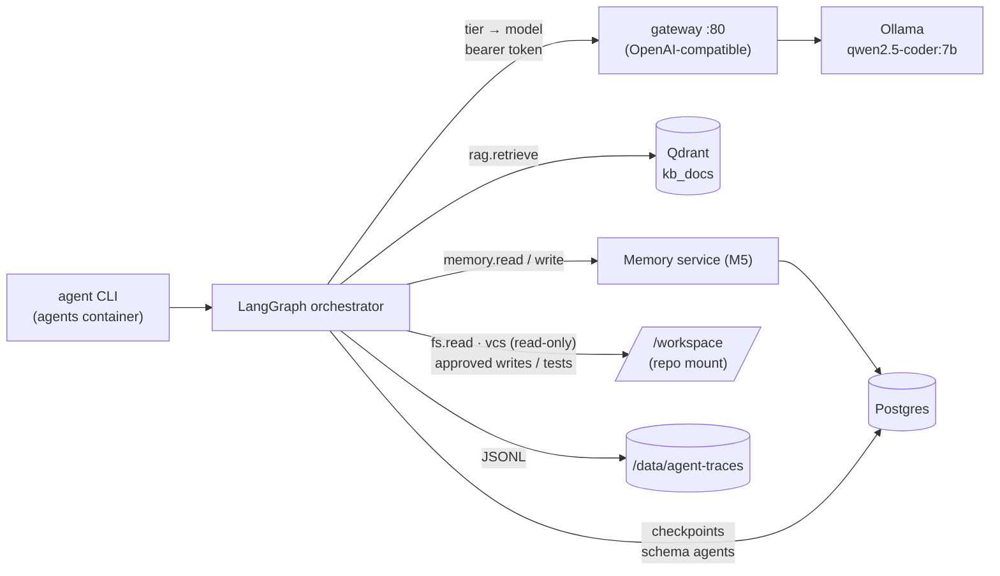

# 06 — Agents (M6)

> **Milestone:** [M6 — Agent Ecosystem](../../implementation/M6-agents.md) ·
> **Anchor:** O5 (FR-030–033), [Phase 07](../phases/07-agent-ecosystem.md) ·
> **Decisions:** [ADR 0008](../adr/0008-agent-orchestration.md) (+ M6 amendment), [ADR 0006](../adr/0006-security-model.md) ·
> **Depends on:** M1 (runtime + gateway), M4 (RAG), M5 (memory).
> Design & roster: [`agents/README.md`](../../agents/README.md).

PAIEP can hand a task to a small team of local agents: a **supervisor** routes it to specialists
(Architect, Software Engineer, Documentation Writer), a **quality gate** (Reviewer, Security) checks any
proposed change, and **you approve** before a single file is written. Everything runs offline on your
machine.

---

## 1. Architecture



| Component | Path |
|-----------|------|
| Personas (CrewAI-style YAML) | [`agents/personas/`](../../agents/personas/) |
| Orchestrator (LangGraph) | [`agents/orchestrator/`](../../agents/orchestrator/) |
| Tool policy + tools | [`agents/tools/`](../../agents/tools/), [`config/tool-policy.yaml`](../../config/tool-policy.yaml) |
| Budgets, gate, context, checkpoints | [`config/agents.yaml`](../../config/agents.yaml) |
| Model router (tier → model) | [`config/router.yaml`](../../config/router.yaml) |
| CLI | [`scripts/agent-cli.py`](../../scripts/agent-cli.py) (Compose service `agents`) |

## 2. Run

```bash
cd docker
docker compose --profile agents up -d ollama gateway qdrant postgres   # M1/M2/M5 must be set up
docker compose --profile agents build agents                             # after code changes

alias agent='docker compose --profile agents run --rm agents'           # or: make agent ARGS='...'
agent personas --all                       # roster (enabled + defined)
agent route "Write an ADR comparing SQLite and Postgres"   # show the plan only (one model call)

# A task: plan -> specialists -> gate -> approval
agent run "Create experiments/demo/textutils.py with a slugify(text) function and a pytest test" \
  --scope project:paiep
#   interactive terminal: shows diffs + reviews and asks "Apply these changes? [y/N]"
#   non-interactive (--no-prompt / CI): leaves the task awaiting approval
agent approve <task_id>                    # apply everything (re-checked) + run approved tests
agent approve <task_id> --path experiments/demo/textutils.py   # apply only some files
agent reject  <task_id>                    # nothing is written

agent run "Explain how PAIEP stays offline" --agent architect  # skip routing
agent status <task_id>    agent trace <task_id>    agent list
```

Approval survives restarts: task state is checkpointed in Postgres (schema `agents`), so `approve` can run
hours later from a new container.

**What you approve.** The approval screen lists each file diff, the gate reviews, any **open gate issues**
(e.g. a requested file still missing) and any **memory writes** the agents propose. Rejecting discards all
of it — files *and* memories. Treat the diff as the real review: on CPU the 7B reviewers catch structural
problems but can miss logic bugs (observed in M6), so read the code and let the approved tests run.

## 3. Configuration

| Key (file) | Default | Effect |
|------------|---------|--------|
| `supervisor.planner` (agents.yaml) | `llm` | `keyword` = no model call for routing |
| `supervisor.examples` | 6 | few-shot routing examples (cached system prompt) |
| `budgets.max_agent_steps` / `max_llm_calls` | 6 / 12 | chain bounds → `partial` result when hit |
| `budgets.max_tool_steps_per_agent` | 1 | read-tool turns before an agent must answer |
| `budgets.task_timeout_s` | 3600 | checked between steps |
| `quality_gate.code` / `docs` | reviewer+security / reviewer | auto-scheduled after changes |
| `quality_gate.veto` / `remediate` | security / reviewer | high severity: block / one fix round |
| (built-in) deterministic checks | on | requested new files present · `.py` compiles · no >50% shrink → one fix round |
| `context.*` | 2 KB + 2 memories, 400 chars | prompt size (CPU cost) |
| `checkpoint.backend` | `auto` | postgres (A+) · sqlite (Profile A) · memory (tests) |
| `endpoint.*` (router.yaml) | gateway `/v1` | `kind: ollama` to bypass the gateway |
| `profiles.<profile>.<tier>` | cpu → `qwen2.5-coder:7b` | tier → model, falls back to installed models |
| `tools.<tool>.enabled` (tool-policy.yaml) | shell/container/web off | global kill-switch |
| `workspace.deny_globs` | secrets, `.git`, DBs, guardrail configs | never readable/writable by agents |

Env: `AGENT_WORKSPACE`, `AGENT_TRACE_DIR`, `AGENT_CHECKPOINT`, `ROUTER_BASE_URL`, `ROUTER_ENDPOINT_KIND`,
`GATEWAY_TOKEN`, `PAIEP_PROFILE`, plus the M4/M5 variables. LangSmith tracing is forced **off**.

## 4. CPU performance (Profile A+)

Measured on the reference laptop (i7-10610U, CPU-only): **cold prompt processing ≈ 6 tokens/s**,
generation ≈ 3.5 tokens/s. Every 1,000 prompt tokens therefore costs ~2.5 minutes, so the runtime:

- keeps prompts small (`context.*`, compact persona prompts, summaries instead of payloads);
- keeps each persona's system prompt and leading context **identical across its turns** and the planner's
  system prompt identical across tasks, so Ollama's **prompt-prefix cache** skips re-processing
  (planner: ~90 s cold → ~15–30 s warm);
- runs Ollama with **one slot** (`OLLAMA_NUM_PARALLEL=1`) and an 8k context (`OLLAMA_CONTEXT_LENGTH`),
  so sequential calls hit the same cache and RAM stays low;
- caps generation per tier (`router.yaml tier_options`) under the gateway's 600 s read timeout.

Expect **minutes per agent step** and **10–25 minutes** for a multi-agent task with review on A+. Profiles
B–D (GPU) cut this by an order of magnitude; raise `context.*`, `max_tool_steps_per_agent` and
`OLLAMA_NUM_PARALLEL` there. Measured numbers: [`benchmarks/m6/`](../../benchmarks/m6/README.md).

## 5. Validate

| Check | How | Expected |
|-------|-----|----------|
| Routing | `python /workspace/benchmarks/m6/route_eval.py` (entrypoint override) | accuracy recorded |
| Grounded single agent | `agent run "..." --agent architect` | answer cites KB/memory sources |
| Multi-agent + approval | code task → `--no-prompt` → `agent approve` | gate ran, files written only after approval, tests pass |
| Least privilege | ask for `docker/.env`, or have docs persona edit `rag/` | `policy.deny` in trace, nothing leaked/written |
| Veto / budgets / remediation | unit tests | blocked / partial / one fix round |
| Offline | egress probe from the `agents` container | `Network is unreachable` |
| Unit tests | `pytest tests/test_agents.py` | green (fake LLM, no services) |

## 6. Troubleshooting

- **`HTTP 401` from the gateway** — `GATEWAY_TOKEN` in `docker/.env` must match for gateway and agents.
- **`HTTP 504` / call takes > 10 min** — prompt too large for CPU: lower `context.*`, `review_chars`,
  `tier_options.max_tokens`; check `ollama ps` shows one runner with an 8192 context.
- **Wrong agent chosen** — `agent route "..."` to inspect; add a few-shot example in `supervisor.examples`
  or `--agent <name>` to bypass routing.
- **`model returned invalid JSON`** — rare with schema-constrained output; the agent retries within its
  turn budget, then returns `failed` (task becomes `partial`).
- **`denied … outside scope`** — by design; widen the persona's `fs_scope.write` in its YAML if the path is
  legitimately its job (protected `deny_globs` cannot be overridden).
- **`denied … already exists: read it with fs.read`** — agents return whole files, so editing an existing
  file requires reading it fully first; ask for a new file, or name the file so the agent reads it. Files
  over `max_read_bytes` (20 KB) are not agent-editable on CPU.
- **Approval shows "open gate issue"** — the fix round did not resolve it; reject, or approve knowingly
  (status becomes `partial`).
- **`collection … missing` / no KB context** — run M2 `qdrant-init.sh` and M3 ingestion.
- **Task stuck `awaiting_approval`** — `agent list`, then `approve` / `reject` it.

## 7. Rollback

1. Stop using the `agents` service; RAG (M4) and memory (M5) work unchanged.
2. Drop task state: `DROP SCHEMA agents CASCADE;` in Postgres (or delete `/data/agents.db` on Profile A);
   traces live in `/data/agent-traces/`.
3. Disable individual personas (`enabled: false`) without touching code, or `git restore agents/ config/`.
4. Approved file changes are ordinary working-tree edits — review with `git diff`, revert with `git restore`.

## References

- [LangGraph — persistence & human-in-the-loop](https://langchain-ai.github.io/langgraph/concepts/human_in_the_loop/)
- [Ollama — OpenAI compatibility & structured outputs](https://github.com/ollama/ollama/blob/main/docs/openai.md)
- [OWASP Top 10 for LLM Applications](https://owasp.org/www-project-top-10-for-large-language-model-applications/)
- [Phase 07 — Agent Ecosystem](../phases/07-agent-ecosystem.md) · [ADR 0008](../adr/0008-agent-orchestration.md)
