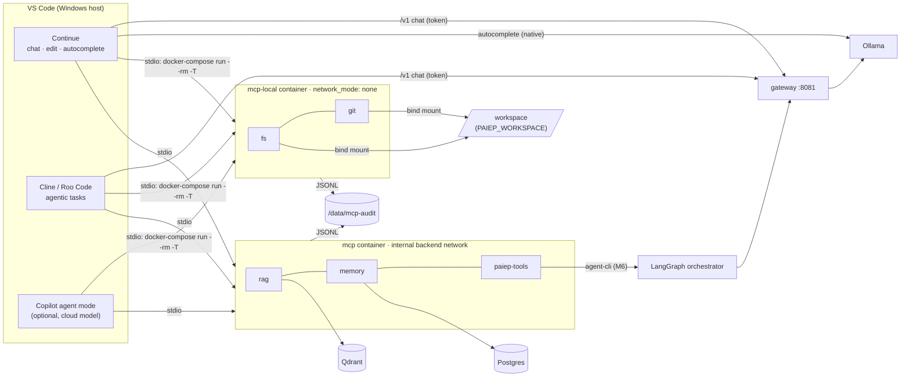

# 07 — VS Code Integration (M7)

> **Milestone:** [M7 — VS Code Integration](../../implementation/M7-vscode-integration.md) ·
> **Anchor:** O6, O7, [Phase 09](../phases/09-vscode-integration.md) ·
> **Decisions:** [ADR 0010](../adr/0010-vscode-integration-strategy.md) (+ M7 amendment), [ADR 0006](../adr/0006-security-model.md) ·
> **Depends on:** M1 (gateway), M4 (RAG), M5 (memory), M6 (agents).

PAIEP plugs into VS Code through **five local MCP servers** (fs, git, rag, memory, paiep-tools) and a
**workspace template** that configures **Continue** (assist + autocomplete), **Cline** (agent; Roo Code as
the alternative) and, optionally, **GitHub Copilot agent mode** — all against the one shared, offline
backend. Policy is enforced **inside the servers**, so no client setting can widen it.

---

## 1. Architecture



| Component | Path |
|-----------|------|
| MCP servers (Python MCP SDK 2.3, stdio) | [`integration/mcp/`](../../integration/mcp/) |
| MCP policy (scopes, deny globs, limits, enabled tools) | [`config/mcp.yaml`](../../config/mcp.yaml) |
| Launcher / capability check | [`scripts/mcp-server.py`](../../scripts/mcp-server.py) (`--list`) |
| Editor-faithful smoke test | [`scripts/mcp-smoke.py`](../../scripts/mcp-smoke.py) |
| Compose services `mcp-local`, `mcp` (profile `mcp`) | [`docker/docker-compose.yml`](../../docker/docker-compose.yml) |
| Workspace template (cookiecutter) | [`templates/workspace/`](../../templates/workspace/) |
| This repo's own editor config | [`.vscode/`](../../.vscode/) |
| Offline tests | [`tests/test_mcp.py`](../../tests/test_mcp.py) |

## 2. MCP surface

Tools that are disabled in [`config/mcp.yaml`](../../config/mcp.yaml) are **not registered** — the model
never sees them. Side-effecting tools carry the MCP `destructiveHint`/non-read-only annotations so clients
ask before running them; the template's auto-approve lists contain **read-only tools only**.

| Server | Tools | Guardrails (server-side) |
|--------|-------|--------------------------|
| **fs** | `fs_list`, `fs_read`, `fs_search`, `fs_propose_write`, `fs_apply_write`⚠ | Workspace-only paths (no `..`/absolute/symlink escape — M6 `ToolPolicy`); secrets, `.git`, keys, DBs, model weights **denied** (case-insensitive on Windows/macOS hosts, where NTFS streams and trailing-dot aliases are also refused); client config, CI, guardrail configs **read-only**; writes are **two-step** (diff → approved apply), single-use, 15-min TTL, refused if the file changed since the proposal, **atomic** (temp file + rename); non-UTF-8 files are never rewritten; size caps |
| **git** | `git_status`, `git_diff`, `git_log`, `git_show`, `git_branches`, `git_create_branch` | argv only; revision/branch names validated (no option injection); `--no-ext-diff --no-textconv`, `core.fsmonitor=false`, empty `core.hooksPath` (repo config/hooks cannot run commands); deny globs excluded from **every** pathspec, including a directory or `.` passed as `path`; **no commit/push tools** |
| **rag** | `rag_search`, `rag_answer` | Read-only; scope ∈ `allowed_scopes` (workspace scope + global); result cap |
| **memory** | `memory_recall`, `memory_list`, `memory_remember`, `memory_forget`⚠ | Reads: workspace scope + global. Writes/deletes: only `writable_scopes` (the workspace scope) and `write_types` (fact/preference/decision/note) |
| **paiep-tools** | `agent_personas`, `agent_route`, `agent_status`, `agent_list`, `agent_run`, `agent_approve`⚠, `agent_reject` | Drives the M6 orchestrator (its tool policy, quality gate and HITL still apply); `agent_run` is async (returns a task id); one running chain at a time; ids/paths validated; tasks are **bound to the workspace + scope that started them** — status/approve/reject/list never see another workspace's tasks (tasks started from the agent CLI are managed from the CLI) |

⚠ = `destructiveHint` — clients always ask. Every call is written to `/data/mcp-audit/<date>.jsonl`
(server, tool, scope, arguments, outcome, latency). Free-text arguments (`content`, `query`, `question`,
`task`) and any value longer than `max_arg_chars` are logged **only as length + sha256**, so
`memory_forget` leaves no plaintext copy in the audit trail. Langfuse tracing arrives with M9.

**Trust boundary — scope.** `PAIEP_SCOPE` comes from the client's MCP config, so it selects (it does not
authenticate) a project: any local client can name any scope. This is acceptable for the single-user,
single-machine design; multi-user hosts (Profile D) need per-user credentials before sharing a backend.

**Containers.** Editors launch two stdio containers per workspace: `mcp-local fs git` runs with
**`network_mode: none`** (it cannot reach anything, even the backend), and `mcp rag memory paiep-tools`
runs on the **internal** backend network (no internet egress). Each server can also run alone
(`... mcp-local fs`), or everything in one process (`all`).

## 3. Design choices (compared)

**Custom PAIEP servers vs. reference MCP servers**

| Option | Benefits | Drawbacks | Verdict |
|--------|----------|-----------|---------|
| **Custom thin servers on PAIEP code** (chosen) | Reuse M6 path policy + deny globs (secrets hidden), PAIEP scopes, audit, two-step writes; one Python stack; offline after image build | ~1k lines to maintain; MCP SDK upgrades are ours | **Adopt** |
| Reference `server-filesystem` / `mcp-server-git` | Maintained upstream, zero code | fs: allowed-dirs only — `.env`/keys readable; git: exposes commit/reset/checkout, no secret filtering; Node/uvx fetch at first launch (not offline) | Rejected for PAIEP defaults |
| Direct REST from clients | Simplest wiring | Bypasses guardrails (rejected in ADR 0010) | Rejected |

**Launch mode**

| Option | Startup | Isolation | Verdict |
|--------|---------|-----------|---------|
| **Docker (`docker-compose run --rm -T`)** (chosen) | ~2–4 s per server start | Only the workspace is mounted; fs/git have no network; same image as M3–M6 | **Default** |
| Host Python (`python scripts/mcp-server.py …`) | < 1 s | Process sees the whole host filesystem (policy still applies; Windows aliases such as `.ENV`, `.env::$DATA` are refused) | Dev / Profile A fallback |
| One server per container ×5 | 5 containers per client | Max separation | Possible; grouped (2) is the default to save RAM |

**Workspace scaffolding**

| Option | Benefits | Drawbacks | Verdict |
|--------|----------|-----------|---------|
| **cookiecutter 2.7.1** (chosen) | Named in the roadmap; Jinja templates; hooks; overlays onto existing repos with `--skip-if-file-exists` | No built-in "update" | **Adopt** — regenerate instead of hand-editing |
| Copier | Template updates (`copier update`) | Heavier; another tool to learn | Future option if drift becomes painful |
| Custom script | Zero deps | Re-implements templating | Rejected |

**Autocomplete model** (Continue, Phase 09 §7): `qwen2.5-coder:1.5b-base` on Ollama-native (~1 GB,
FIM-trained *base* model; the 7B chat model is too slow for keystroke latency on CPU). Added as the
`autocomplete` tier in [`config/models.yaml`](../../config/models.yaml) (3B / 7B base on GPU / server profiles).

## 4. Set up

> **Step-by-step for this Windows machine** (Continue + Cline, including the fixes found in practice):
> [07-vscode-new-workspace.md](07-vscode-new-workspace.md).

### 4.1 Backend + image (once)

```bash
cd docker
docker compose --profile mcp build mcp              # image now includes the MCP SDK + servers
docker compose --profile mcp up -d gateway qdrant postgres     # or: make mcp-up
docker exec paiep_ollama ollama pull qwen2.5-coder:1.5b-base   # autocomplete tier (or scripts/pull-models.sh)
make mcp-list                                       # capability check: 24 tools
```

Windows checkouts (Git for Windows defaults to `core.autocrlf=true`): set `PAIEP_GIT_AUTOCRLF=true` in
`docker/.env`, otherwise `git_status` inside the container reports every CRLF file as modified.

### 4.2 Scaffold a workspace (one command)

```bash
pip install cookiecutter==2.7.1           # or: pip install -r requirements-dev.txt
# New workspace dir, or overlay an existing repo (existing files are kept):
cookiecutter <PAIEP>/templates/workspace -o <parent-dir> --no-input --overwrite-if-exists --skip-if-file-exists \
  project_name=my-repo project_slug=my-repo
# equivalent: make -C docker workspace DIR=<parent-dir> NAME=my-repo [ARGS="copilot=disabled agent_client=roo"]
```

Use an **absolute** template path (or pass `paiep_home=`) — the post-generation hook resolves the PAIEP
checkout from it. If this machine overrides the published Ollama port, set `ollama_url` to match
(`OLLAMA_HOST_PORT` in `<PAIEP>/docker/.env`). Options: `memory_scope` (default `project:<slug>`), `compose_cli` (`docker-compose` |
`docker compose`), `inline_provider` (`continue` | `copilot` | `none`), `copilot` (`enabled` | `disabled`
— disabled sets `chat.disableAIFeatures` for sensitive repos), `copilot_mcp` (`no` | `yes`),
`agent_client` (`cline` | `roo`), model names and URLs. Generated files and what to commit are listed in
the workspace's `.paiep/README.md`.

### 4.3 Clients

| Client | Model endpoint | MCP config | Notes |
|--------|----------------|------------|-------|
| **Continue** | `.continue/models/paiep.yaml`: chat/edit/apply → gateway `http://127.0.0.1:8081/v1` (`authorization: Bearer ${{ secrets.PAIEP_GATEWAY_TOKEN }}` request header, secret from git-ignored `.continue/.env`); autocomplete → Ollama `:11434` | `.continue/mcpServers/paiep.yaml` | MCP tools are used in Continue's **agent** mode |
| **Cline** | Settings → API provider *OpenAI Compatible*, base URL `http://127.0.0.1:8081/v1`, model `qwen2.5-coder:7b`, key = `GATEWAY_TOKEN` | Merge `.paiep/cline_mcp_settings.json` into Cline's **global** `cline_mcp_settings.json` (server names carry the repo slug) | `timeout` 900 s for the backend server (`rag_answer`, approvals) |
| **Roo Code** (alt.) | Same as Cline | Project-level `.roo/mcp.json` | Install Cline **or** Roo, not both |
| **Copilot agent mode** | Copilot's own (cloud) models | `.vscode/mcp.json` (only with `copilot_mcp=yes`; this repo ships one with `${workspaceFolder}` paths) | Tool results leave the machine — see §5 |

Why `docker-compose` (not `docker compose`) on Windows: MCP clients start servers with a **minimal
environment**; without `%ProgramFiles%` the Docker CLI cannot find its `compose` plugin
(`unknown shorthand flag: 'f'`). Docker Desktop's standalone `docker-compose.exe` has no such lookup. On
Linux/WSL Docker Engine, `docker compose` works (`compose_cli="docker compose"`).

### 4.4 Verify

```bash
python scripts/mcp-smoke.py --workspace <repo> --scope project:<slug> --write   # every server, like an editor
python scripts/mcp-smoke.py --deep                                              # + local-model calls
python scripts/mcp-smoke.py --agent software_engineer --agent-task "..." [--approve]   # agent e2e over MCP
```

In the editor: Continue → agent mode → ask *"Use rag_search: what is PAIEP's default chat model?"*; Cline →
MCP Servers shows both servers green with their tools; Copilot (this repo) → *MCP: List Servers*.

## 5. Copilot coexistence

| Rule | How the template enforces it |
|------|------------------------------|
| **One inline provider** per workspace | `inline_provider` sets `continue.enableTabAutocomplete` and `github.copilot.enable` consistently |
| **Sensitive repo → PAIEP only** | `copilot=disabled` → `chat.disableAIFeatures: true`, Copilot inline off, Copilot extensions marked unwanted, no `copilot-instructions.md` |
| **PAIEP tools and the cloud** | `.vscode/mcp.json` is generated **only** with `copilot_mcp=yes`: Copilot's model runs in the cloud, so anything a PAIEP tool returns (KB passages, memories, file content) leaves the device. Continue/Cline use their own config files and the local model |
| **Distinct chat surfaces** | Copilot Chat = cloud; Continue/Cline panels = local. No shared keybindings are added |
| **Copilot BYOK → local endpoint** | Not configured: ⚠ verify current support before relying on it (ADR 0010 follow-up) |

## 6. Per-profile guidance

| Profile | Autocomplete | Chat / agent | MCP |
|---------|--------------|--------------|-----|
| **A** (16 GB CPU) | 1.5B base or **off** (Copilot inline if online) | 7B chat, short Cline tasks | `all` in **one** process (`mcp-server.py all`, host Python or one container) to save RAM; skip `rag_answer` |
| **A+** (primary) | `qwen2.5-coder:1.5b-base` | 7B via gateway; `agent_run` for background work (minutes) | 2 containers per client (default) |
| **B/C** (GPU) | 3B base | 14B; longer Cline chains | default; raise `paiep-tools.max_running` |
| **D** (server) | 7B base | 32B; concurrent agents | point `gateway_url` at the LAN host; MCP still local stdio (or streamable-HTTP later) |

## 7. Troubleshooting

| Symptom | Cause / fix |
|---------|-------------|
| Server shows "connection closed", log says `unknown shorthand flag: 'f'` | `docker compose` under a minimal env (Windows) → use `docker-compose` (`compose_cli`) |
| Every file "modified" in `git_status` | Windows CRLF checkout → `PAIEP_GIT_AUTOCRLF=true` in `docker/.env` |
| `DENIED: ...` | Working as intended — the reason names the rule (deny glob, scope, type). Change [`config/mcp.yaml`](../../config/mcp.yaml), not the client |
| Tool missing from the list | Disabled tools are not registered; check `make mcp-list ARGS="fs git"` |
| Client timeout on `rag_answer` / `agent_approve` | CPU generation takes minutes: raise the client's MCP timeout (Cline `timeout`), prefer `rag_search`, use `agent_run` + `agent_status` |
| Continue agent request aborted after exactly 10 min (gateway log `499`, then a retry) | CPU reads prompts at ~5 tok/s and an agent prompt with all tool schemas is 3k+ tokens. The template sets `requestOptions.timeout: 1800000` (milliseconds for Continue's OpenAI client, multiplied by 1000 for its socket timer, so keep it below 2147483), matching the gateway's 1800 s. Older workspaces: add it by hand. Use **Chat** mode with `@file` context or fewer enabled tools for faster replies. Later turns reuse Ollama's prompt cache if nothing else ran in between |
| First call slow / container start each session | Normal: `run --rm` starts a fresh container (~2–4 s); backend services must be up (`make mcp-up`) |
| Continue chat 401 / "API key secret not found" | `PAIEP_GATEWAY_TOKEN` in `.continue/.env` must equal `GATEWAY_TOKEN` in `docker/.env`. Continue pastes secrets into its YAML before parsing it, so an **all-digit** token in `apiKey` becomes a number. The template therefore sends `requestOptions.headers.authorization: Bearer ${{ secrets.PAIEP_GATEWAY_TOKEN }}` instead (regenerate older workspaces). If the secret is still not found, also add it to the per-user `~/.continue/.env` and run **Developer: Reload Window** |
| Autocomplete says model not found / times out | Check `ollama list`, `OLLAMA_HOST_PORT` in PAIEP's `docker/.env`, and template `ollama_url`; ensure `qwen2.5-coder:1.5b-base` is pulled |
| Code change not picked up | The servers run from the image: `docker compose --profile mcp build mcp` |
| Files written by MCP owned by root (Linux hosts) | Containers run as root; on Linux add `user: "${UID}:${GID}"` to the `mcp*` services |
| Config drift across repos | Re-run the template (`--overwrite-if-exists` without `--skip-if-file-exists`) instead of hand-editing |

## 8. Rollback

- Remove client config: delete `.vscode/mcp.json`, `.continue/`, `.clinerules/`/`.roo/` from a workspace and
  the PAIEP entries from Cline's global settings → editors no longer start the servers.
- Platform: `git restore`/revert `integration/`, `templates/`, `config/mcp.yaml`, `.vscode/`, the `mcp*`
  Compose services and the `--task-id` CLI flag; rebuild the image. M1–M6 are untouched (no schema or data
  changes; audit logs are plain files under `/data/mcp-audit`).

## References

- [Phase 09 — VS Code Integration](../phases/09-vscode-integration.md) · [ADR 0010](../adr/0010-vscode-integration-strategy.md) · [ADR 0006](../adr/0006-security-model.md)
- Model Context Protocol — <https://modelcontextprotocol.io> · Python SDK 2.x — <https://py.sdk.modelcontextprotocol.io/v2/>
- VS Code MCP configuration — <https://code.visualstudio.com/docs/copilot/chat/mcp-servers>
- VS Code AI settings (`chat.disableAIFeatures`) — <https://code.visualstudio.com/docs/agents/reference/ai-settings>
- Continue config / MCP — <https://docs.continue.dev/reference>, <https://docs.continue.dev/customize/deep-dives/mcp>
- Cline MCP — <https://docs.cline.bot/mcp/mcp-overview>
- cookiecutter — <https://cookiecutter.readthedocs.io>
