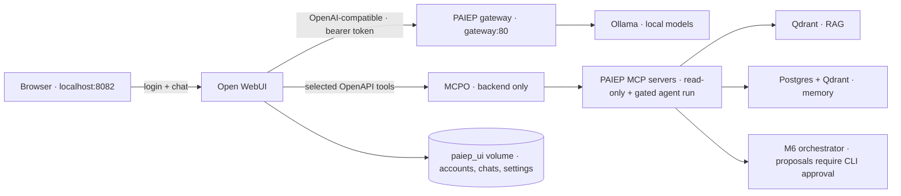

# 08 — Local Chat UI (M8)

> **Optional:** Open WebUI is a local chat client. VS Code remains the primary PAIEP interface.
> The service is loopback-only; do not change `BIND_HOST` to `0.0.0.0`.

## What runs



Open WebUI was selected in [Phase 06](../phases/06-technology-selection.md#12-layer-11--ui) and
[ADR 0007](../adr/0007-reference-stack.md). AnythingLLM offers turnkey workspaces and RAG, but is
more opinionated and duplicates PAIEP's retrieval path. A custom UI would provide tighter control
but adds ongoing application code contrary to ADR 0003. The adopted Open WebUI provides chat and
model selection; the existing MCP tools are exposed through MCPO (MIT) as OpenAPI. This small
adapter avoids a second implementation of RAG, memory, or agent policy.

## Start

Prerequisites: Docker Compose, the PAIEP chat model and `EMBED_MODEL` (default
`nomic-embed-text`) pulled into Ollama, and the M1–M6 services available. Open WebUI uses that local
Ollama embedding model for RAG instead of downloading its default SentenceTransformers model.
The first build/pull requires internet; once images and models are present, chat and tools are local.
The RAG environment values seed a new `paiep_ui` volume; Open WebUI's saved admin configuration
takes precedence on an existing volume. If that volume was previously initialized with defaults,
set **Admin Settings → Documents → Embedding** to Ollama and choose the same `EMBED_MODEL`. Automatic
SentenceTransformers model downloads are disabled.

1. Copy `docker/.env.example` to `docker/.env` if needed. Keep this file private and git-ignored.
2. Set independent, persistent secrets for Open WebUI and MCPO. From the repository root, generate
   each with:

   ```powershell
   .\.venv\Scripts\python.exe -c "import secrets; print(secrets.token_urlsafe(48))"
   ```

   In WSL/Linux, use `python3 -c "import secrets; print(secrets.token_urlsafe(48))"`.
   Save one as `WEBUI_SECRET_KEY` and another as `MCP_UI_API_KEY` in `docker/.env`. Do not rotate
   the WebUI key while its persistent volume is in use; back up the volume before changing it.
3. Optionally set `PAIEP_SCOPE=project:<name>` for RAG, memory and agent tasks. The default is
   `global`. Scope is a client-selected namespace, not user authentication.
4. Start the optional profile:

   ```powershell
   docker-compose --profile ui up -d ui
   # or: make -C docker ui-up COMPOSE="docker-compose"
   ```

5. Open <http://127.0.0.1:8082>. Create the first account; Open WebUI promotes it to the local
   administrator and closes public signup. `WEBUI_AUTH=true` keeps authentication enabled.
   The `ui` profile publishes only `BIND_HOST` (default `127.0.0.1`).

For a separate project workspace, set `PAIEP_WORKSPACE` to its absolute host path in `docker/.env`.
The UI agent tools mount that workspace read-only. The M6 CLI approval service uses the same
`PAIEP_WORKSPACE` mount so any separately approved proposal targets the same files.

## Connect the local model gateway

Open **Admin Settings → Connections → OpenAI API** and add:

| Setting | Value |
|---------|-------|
| Base URL | `http://gateway/v1` |
| API key | the `GATEWAY_TOKEN` value in `docker/.env` |

This address is for Open WebUI's backend container on the Compose network; do not use
`localhost:8081` from inside the container. Save the connection and confirm that the Ollama
models appear. Select a model with reliable native tool calling for RAG and agent tools.

## Enable PAIEP tools

Open **Admin Settings → Integrations → Tools**, add the OpenAPI server
`http://paiep-tools-api:8000`, and select **Bearer** authentication with the `MCP_UI_API_KEY`
value. Set **ID** to `paiep` and **Name** to `PAIEP`. Otherwise the chat **+ → Tools** menu shows an
unlabelled toggle. Open WebUI lists the whole server as one entry, and that toggle enables all of
its PAIEP tools. MCPO's `--strict-auth` protects tool routes and generated API docs. Open WebUI's admin-added
tool requests are made server-side, so the internal Compose hostname is intentional. In each chat,
enable the needed PAIEP tools from the **+ → Tools** menu.

The UI-specific MCP policy in [`config/mcp-ui.yaml`](../../config/mcp-ui.yaml) is deliberately
safer than the editor policy:

| Available | Not exposed to model calls |
|-----------|----------------------------|
| `rag_search` (the chat model answers from the cited passages); memory recall/list; agent personas, routing, status/list, and `agent_run` | `rag_answer` (a second multi-minute CPU generation per question), file writes, memory remember/forget, `agent_approve`, and `agent_reject` |

An agent task started in the UI can return a plan and proposed diffs, but it stops at the M6
approval gate. Review the status/diff in chat, then explicitly approve or reject from the local
CLI; this prevents an automatically selected OpenAPI tool call from applying changes:

```powershell
docker-compose --profile agents run --rm agents status <task-id>
docker-compose --profile agents run --rm agents approve <task-id>
# or: docker-compose --profile agents run --rm agents reject <task-id>
```

The default workspace is this repository. For a different workspace, set the same
`PAIEP_WORKSPACE` before running the CLI command. Approval runs the configured M6 quality gate
and approved test actions; it may take several minutes on CPU.

## Validation

1. Confirm `http://127.0.0.1:8082` shows a login page and the first account can sign in.
2. Confirm local models appear, select one, and complete a simple chat.
3. Enable `rag_search`, ask about an ingested PAIEP note, and verify a cited passage is returned.
4. Enable `agent_route` or `agent_run`; for a write task verify status shows a pending proposal and
   no file changes occur until CLI approval.
5. Restart the optional services and confirm login, settings, and chat history remain available:

   ```powershell
   docker-compose --profile ui restart ui paiep-tools-api
   ```

6. Confirm published address is loopback-only:

   ```powershell
   docker-compose --profile ui ps
   ```

### Operations and rollback

```powershell
docker-compose --profile ui logs -f ui paiep-tools-api
docker-compose --profile ui stop ui paiep-tools-api
```

Stopping services preserves `paiep_ui` (accounts, chats and settings) and `paiep_memory` (audit,
agent traces and checkpoints). Do not use `down -v` to disable the UI; that deletes persistent
data. To remove only UI state, first back up the `paiep_ui` volume, then remove that named volume
after stopping the stack.

The UI has no public/remote-access hardening in M8. Do not expose it on a LAN or reverse proxy;
remote access requires the M10 security milestone.

## Troubleshooting

| Symptom | Check |
|---------|-------|
| No models | Gateway is healthy; OpenAI connection uses `http://gateway/v1` and the matching `GATEWAY_TOKEN`; model is pulled |
| Tool API auth error | MCPO connection uses Bearer `MCP_UI_API_KEY`; `--strict-auth` is enabled |
| Tool server not reachable | `paiep-tools-api` and UI share the `backend` network; use `http://paiep-tools-api:8000` |
| Signup unavailable on first run | Check the UI volume is empty; if it already has a user, sign in with that admin account |
| Sign-in breaks after restart | Keep the same `WEBUI_SECRET_KEY`; inspect `ui` logs |
| Agent runs but has no apply tool | Expected: approve/reject are disabled in the UI policy; use the local M6 CLI after reviewing the diff |
| UI port is occupied | Set `OPENWEBUI_HOST_PORT` in `docker/.env`; keep `BIND_HOST=127.0.0.1` |
| 504 Gateway Time-out / no first token | CPU prompt processing (~5 tok/s on the reference laptop) exceeded the gateway's read timeout (1800 s; was 600 s). Keep title/tags/follow-up generation, code interpreter, memories and model **Builtin Tools** off (Compose seeds this; check **Admin Settings** on older volumes). Enable PAIEP tools only in chats that need them. Then `docker restart paiep_ollama` to drop the abandoned request |
| No models after changing `GATEWAY_TOKEN` | The gateway reads it only when created: `docker-compose --profile ui up -d --force-recreate gateway paiep-mcp-http paiep-tools-api`, then update the key in the connection |
| Chat fails with Responses API / 404 | Set the connection's **API Type** to **Chat Completions**; Ollama has no `/v1/responses` |
| 413 Request Entity Too Large after attaching an image | The default models are text-only, and base64 images exceed the gateway's 1 MB body limit. Vision is off by default so attachments are blocked. Describe the diagram as text (for example, paste the Mermaid source) or add a vision model and enable **Vision** for it |

## References

- [Open WebUI documentation](https://docs.openwebui.com/)
- [Open WebUI authentication and first-run admin](https://docs.openwebui.com/security/accepted-risks/first-run-bootstrap-window/)
- [Open WebUI OpenAPI tool integration](https://docs.openwebui.com/features/extensibility/plugin/tools/openapi-servers/open-webui/)
- [Open WebUI MCP / MCPO integration](https://docs.openwebui.com/features/extensibility/plugin/tools/openapi-servers/mcp/)
- [MCPO v0.0.20](https://github.com/open-webui/mcpo/releases/tag/v0.0.20)
